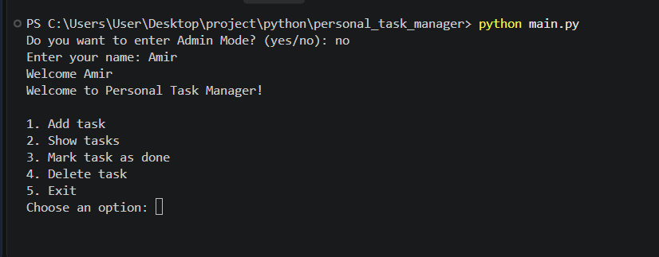
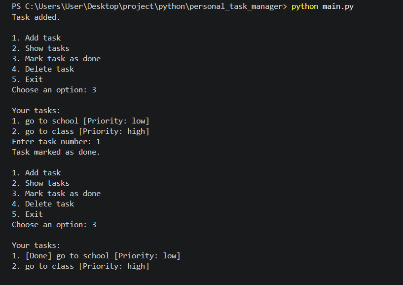
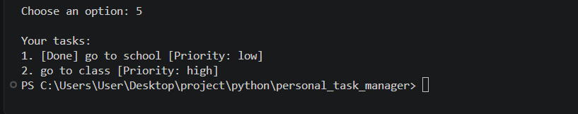
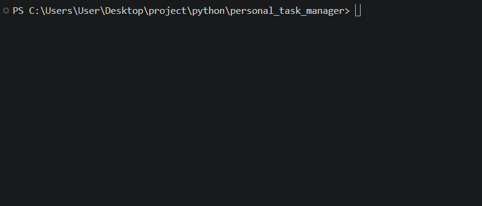

# 📋 Personal Task Manager

A simple command-line task manager built with Python. Add tasks, assign priorities, mark tasks as done, delete tasks, and save them locally.

<p align="left">
  
  
  
  
</p>

---

## 📑 Table of Contents

- [Features](#-features)
- [Project Structure](#-project-structure)
- [File Description](#-file-description)
- [Requirements](#️-requirements)
- [Installation](#-installation)
- [Environment Setup](#-environment-setup)
- [Usage](#️-usage)
- [Example Output](#-example-output)
- [Screenshots](#-screenshots)
- [Demo](#-demo)
- [Roadmap](#️-roadmap)
- [Contributing](#-contributing)
- [License](#-license)
- [Author](#-author)

---

## ✨ Features

### ✅ Task Management

- Add tasks through the terminal.
- Prevent empty tasks from being added.
- Display tasks in a numbered list.
- Mark tasks as done.
- Delete tasks.
- Associate tasks with a user's name.

### 🎯 Task Priority

- Assign a priority to each task.
- Choose from three priority levels: `low`, `medium`, and `high`.
- Validate priority input and reject unsupported values.
- Display the selected priority alongside each task.

### 💾 Task Storage

- Save tasks locally in `tasks.txt`.
- Load previously saved tasks.
- Keep task data on the local machine.
- Store tasks separately for different names.

### 🔐 Admin Mode

- Choose whether to enter Admin Mode.
- Verify the admin password.
- Load the password from `.env`.
- Keep the actual password outside the main Python source code.

---

## 📁 Project Structure

```text
personal_task_manager/
├── main.py
├── tasks.py
├── .env.example
├── .gitignore
├── requirements.txt
├── README.md
├── Screenshots/
│   ├── pic1.png
│   ├── pic2.png
│   └── pic3.png
└── gifs/
    └── demo.gif
```

**Note:** `.env` and `tasks.txt` are local files and should be ignored by Git. They should not be uploaded to the public repository.

---

## 📄 File Description

| File or Folder | Description |
|---|---|
| `main.py` | Main program and task management logic |
| `tasks.py` | Contains the task display function |
| `.env.example` | Example environment variable configuration |
| `.gitignore` | Specifies files Git should ignore |
| `requirements.txt` | Lists required Python packages |
| `README.md` | Project documentation |
| `Screenshots/` | Stores screenshots of the program |
| `gifs/` | Stores the demo GIF |
| `.env` | Local admin password configuration; not tracked by Git |
| `tasks.txt` | Local task data; not tracked by Git |

---

## 🛠️ Requirements

Make sure you have the following installed:

- Python 3
- `pip`
- `python-dotenv`

---

## 📦 Installation

### 1. Clone the repository

```bash
git clone https://github.com/a-h-ourghali/personal_task_manager.git
```

### 2. Open the project folder

```bash
cd personal_task_manager
```

### 3. Check your Python version

```bash
python --version
```

### 4. Install the required packages

```bash
pip install -r requirements.txt
```

---

## 🔐 Environment Setup

The project uses a `.env` file to store the Admin Mode password outside the Python source code.

### 1. Create `.env` from `.env.example`

On Windows PowerShell:

```powershell
Copy-Item .env.example .env
```

### 2. Configure the password

Open `.env` and set the following variable:

```dotenv
TASK_MANAGER_ADMIN_PASSWORD=your_password_here
```

Replace `your_password_here` with your own test password.

**Important:** Never commit `.env` or share your real password. Keep `.env.example` in the repository without any real secrets.

---

## ▶️ Usage

### 1. Run the program

```bash
python main.py
```

### 2. Choose whether to enter Admin Mode

When the program starts, choose `yes` or `no`.

If you choose `yes`, enter the admin password configured in `.env`.

### 3. Enter your name

Enter your name to load your previously saved tasks.

### 4. Use the menu

The program provides the following options:

1. **Add task** — Add a new task and choose its priority.
2. **Show tasks** — Display your saved tasks.
3. **Mark task as done** — Mark a task as completed.
4. **Delete task** — Remove a task from your list.
5. **Exit** — Finish and save your changes.

Choose a priority of `low`, `medium`, or `high` when adding a task.

Tasks are saved in `tasks.txt` and loaded again when you run the program with the same name.

---

## 💻 Example Output

The following is an illustrative example. Exact prompts may vary depending on the current program version.

```text
Do you want to enter Admin Mode? (yes/no): no
Enter your name: Alex
Welcome Alex
Welcome to Personal Task Manager!

1. Add task
2. Show tasks
3. Mark task as done
4. Delete task
5. Exit

Choose an option: 1
Enter a task: Finish homework
Enter priority (low/medium/high): high
Task added.

Choose an option: 2

Your tasks:
1. Finish homework [Priority: high]
```

---

## 📸 Screenshots

The following images demonstrate the program interface. Replace the example image files with your latest screenshots.

### 🚀 Program Start



### ✍️ Adding Tasks



### 📋 Task List



---

## 🎬 Demo

Watch the program in action:



Replace `gifs/demo.gif` with a recent recording that demonstrates the main features, including task priorities.

---

## 🗺️ Roadmap

### Completed

- [x] Add tasks through the terminal
- [x] Validate empty task input
- [x] Save tasks locally
- [x] Load saved tasks
- [x] Display tasks in a numbered list
- [x] Add Admin Mode
- [x] Load the admin password from `.env`
- [x] Add task priorities (`low`, `medium`, `high`)
- [x] Mark tasks as done
- [x] Delete tasks

### Planned

- [ ] Add task editing
- [ ] Add more Admin Mode features
- [ ] Improve the user interface
---

## 🤝 Contributing

Contributions and suggestions are welcome.

If you find a bug or have an idea for improving the project, feel free to open an issue or submit a pull request.

---

## 📜 License

License information will be added later.

---

## 👨‍💻 Author

**Amirhossein Sourghali**

[](https://github.com/a-h-ourghali)

[Visit my GitHub profile](https://github.com/a-h-ourghali)
